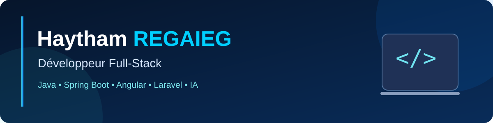

# 👋 Bonjour, je suis Haytham REGAIEG

**Élève ingénieur en informatique · Développeur Full-Stack · Passionné par l'IA**

📍 Lyon, France &nbsp; | &nbsp; 🎓 CESI Lyon  
🎯 **Recherche un stage de fin d'études de 6 mois dès février 2027**

---

## 👨‍💻 À propos de moi

Je suis **élève ingénieur en 5ᵉ année de Génie Informatique**, actuellement à **CESI Lyon** dans le cadre d'un échange académique avec l'**IIT Sfax**. J'aime concevoir des applications web fiables, sécurisées et agréables à utiliser, du back-end à l'interface utilisateur.

- 💻 **Full-Stack :** Java, Spring Boot, Angular, Laravel et PHP
- 🔐 **Back-end :** API REST, authentification JWT et tests unitaires
- ⚙️ **Outils :** Git, Docker, Jenkins, CI/CD et Agile/Scrum
- 🤖 **Centres d'intérêt :** intelligence artificielle et machine learning
- 🚀 **Objectif :** rejoindre une équipe de développement pour mon stage PFE

## 🛠️ Compétences techniques

**Langages**  
     

**Frameworks & Web**  
    

**Bases de données & outils**  
     

## 🚀 Projets à découvrir

### 🛒 [ShopFlow](https://github.com/haythamregaieg/shopflow)
Application e-commerce développée en **Java / JEE**.  
[Explorer le dépôt](https://github.com/haythamregaieg/shopflow)

### 📋 [Gestion des réclamations](https://github.com/haythamregaieg/Reclamation-Management-Laravel-Angular)
Application web Full-Stack de gestion des réclamations.  
**Technologies :** Laravel, Angular, PHP, TypeScript.  
[Explorer le dépôt](https://github.com/haythamregaieg/Reclamation-Management-Laravel-Angular)

## 📊 Activité GitHub

> Ces statistiques sont fournies par un service tiers et peuvent être temporairement indisponibles. Elles ne mesurent pas l'ensemble de mes compétences.

## 🎓 Formation

**CESI Lyon — France** · 2026–2027  
5ᵉ année en informatique, programme d'échange académique.

**Institut International de Technologie (IIT) — Sfax, Tunisie**  
Cycle ingénieur en Génie Informatique.

## 🤝 Me contacter

Je suis ouvert aux opportunités de **stage PFE en développement Full-Stack, génie logiciel ou intelligence artificielle**.

📧 [haythamregaieg11@gmail.com](mailto:haythamregaieg11@gmail.com) · 💼 [LinkedIn](https://www.linkedin.com/in/haythamregaieg/) · 💻 [GitHub](https://github.com/haythamregaieg)

---

<i>« Apprendre, concevoir, développer et innover. »</i>

